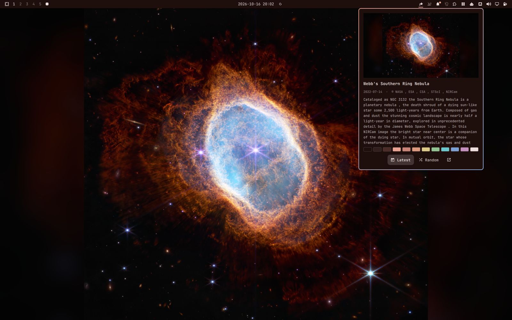

# NASA APOD for Omarchy

NASA's [Astronomy Picture of the Day](https://science.nasa.gov/apod/) as your Omarchy wallpaper, in an **APOD** theme whose colours come from the picture. A red nebula gives a deep red theme, a blue twilight sky gives a blue one. Every terminal, editor, the bar, window borders and the lock screen follow along, and the text stays readable.



This is the Omarchy version of [kde-apod](https://github.com/smolamSK/kde-apod).

## Features

- **Daily wallpaper.** NASA's new picture shortly after it is published, and at login if the computer was off. On days when APOD is a video, the most recent photo stays.
- **A theme from every picture.** The picture's strongest colours become the accent and the window-border gradient, and its dark sky tints the background. Terminal colours keep their meaning (red is still red) but lean towards the picture's own hues. Every text colour is checked against the background and adjusted until it is readable.
- **Light or dark.** Bright pictures get a light theme, the rest (most of the sky) a dark one. You can also pick one.
- **Fitted to your screen.** If the picture's shape is close to your monitor's, it is cropped to fill it. If the shapes are very different (a tall photo on a wide screen), the whole picture is shown over a blurred copy of itself.
- **Notification** with the title, credit and NASA's explanation when the picture changes.
- **Bar widget** with the picture, its story, the theme's colours, and:
  - **Latest:** NASA's new picture every day.
  - **Random:** a random picture from the archive every day. Click **Shuffle** for another one right away, or middle-click the bar icon.
  - **Use theme:** shown when you've switched to another theme; switches back to the APOD theme.
  - Click the picture to open its page on science.nasa.gov.

## Requirements

Omarchy 4 with the Omarchy shell. Everything else it uses (ImageMagick, jq, curl, Python 3, libnotify) is part of a standard Omarchy install.

## Install

```sh
omarchy plugin add https://github.com/smolamSK/omarchy-apod --enable
```

The first picture arrives about 20 seconds later, and Omarchy switches to the APOD theme.

**Get a free NASA API key** at https://api.nasa.gov (it is shown as soon as you sign up) and paste it into the widget's settings. Without one, the shared `DEMO_KEY` is used. It is limited per IP address and runs out quickly, especially when using Random. When the API is unavailable, the picture is read from the APOD website instead.

## Settings

In the widget's settings in Omarchy:

| Setting | Default | Meaning |
|---|---|---|
| NASA API key | empty (`DEMO_KEY`) | Your key from api.nasa.gov. |
| Theme brightness | Auto | Auto, Dark or Light. Auto picks light for bright pictures. |
| Colour strength | Balanced | Subtle, Balanced or Vivid: how strongly the picture tints the theme. |
| Announce new pictures | on | The notification when the picture changes. |

Changing the brightness or colour strength rebuilds the theme from the current picture right away.

## Switching themes

The APOD theme is an ordinary Omarchy theme called **Apod**, in the theme switcher like any other. When you switch to another theme, new pictures still arrive and the APOD theme is kept up to date, but your chosen theme stays until you pick **Apod** again (or click **Use theme** in the widget).

The theme is rewritten with every picture, so don't edit it by hand. To keep a palette you like, copy it first: `cp -r ~/.config/omarchy/themes/apod ~/.config/omarchy/themes/my-nebula`.

## Command line

The plugin's script also works from a terminal:

```
~/.config/omarchy/plugins/io.github.smolamsk.apod/bin/omarchy-apod help
```

```
omarchy-apod update [--date YYYY-MM-DD]  daily run: newest picture, or a random one in random mode
omarchy-apod latest                      switch to latest mode and show today's picture
omarchy-apod random                      switch to random mode and show a random archive picture
omarchy-apod use                         switch to the APOD theme with the current picture
omarchy-apod apply                       rebuild the theme from the current picture (after a settings change)
omarchy-apod preview IMAGE               print the colors.toml a picture would get; changes nothing
omarchy-apod configure                   save settings from one line of JSON on stdin (the bar widget uses this)
omarchy-apod notify                      show the current picture's title again
omarchy-apod status                      current picture, mode and palette as JSON (for the bar widget)
omarchy-apod help                        these commands, plus which NASA API key is used
```

`preview` works on any picture, so you can see what theme your own photos would make.

## Update and uninstall

```sh
omarchy plugin update io.github.smolamsk.apod
```

```sh
omarchy theme set "Tokyo Night"          # or any other theme, first
omarchy plugin remove io.github.smolamsk.apod
omarchy theme remove apod                # the generated theme
rm -rf ~/.local/share/omarchy-apod       # downloaded pictures and settings
```

## How it works

| Part | Where |
|---|---|
| Fetching, rendering, theme building | `bin/omarchy-apod` (Bash) |
| Picture → palette | `bin/apod-palette.py` (Python standard library, colours in OKLCH) |
| Scheduling (20 s after login, then hourly) | `Service.qml`. The script returns at once when there is nothing new, and asks NASA at most every 3 hours. |
| Bar widget | `Widget.qml` |
| The theme | `~/.config/omarchy/themes/apod/`: `colors.toml`, one background, `preview.jpg` |
| Pictures, settings, state | `~/.local/share/omarchy-apod/`, private to your user |

Omarchy generates everything else in the theme (terminals, btop, editors, the bar, Hyprland borders) from `colors.toml`, the same way as for its own themes.

## Troubleshooting

- **See what happened:** run `bin/omarchy-apod update` (or `latest`) from the plugin folder in a terminal; it explains each step.
- **"NASA API rate limit reached":** you're using `DEMO_KEY`. Get a free key and paste it into the widget's settings.
- **Wrong fit after changing your monitor's resolution or rotation:** click **Latest** or **Shuffle**, or run `omarchy-apod apply`.

## License

GPL-2.0-or-later. Pictures are © their respective authors, as credited on APOD.
